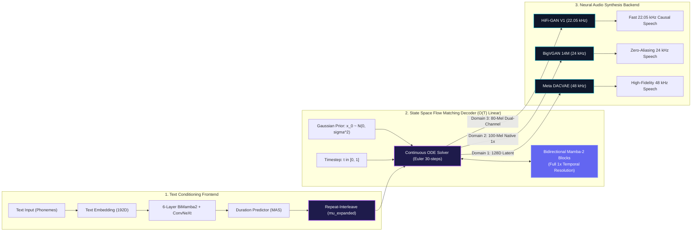

# MambaFlow-TTS: Eliminating Multiscale Aliasing via Full-Resolution State Space Flow Matching

[](https://monesh01.github.io/MambaFlow-TTS/)
[](BENCHMARK_REPORT.md)
[](LICENSE)
[](https://python.org)
[](https://pytorch.org)
[](https://developer.nvidia.com/cuda-toolkit)

**Author**: Monesh S ([@Monesh01](https://github.com/Monesh01))  
**Institution**: Saveetha University, Chennai  
**Interactive Audio Showcase**: [https://monesh01.github.io/MambaFlow-TTS/](https://monesh01.github.io/MambaFlow-TTS/)  

---

## 🌟 Executive Summary

**MambaFlow-TTS** is a high-fidelity, linear-complexity Text-to-Speech (TTS) architecture uniting **Continuous Optimal Transport Conditional Flow Matching (OT-CFM)** with **Bidirectional Mamba-2 State Space Models (SSMs)**.

### The Problem: Destructive Multiscale Aliasing & Comb-Filtering
Current diffusion and flow-matching speech generators commonly adopt multiscale temporal pyramids (e.g., U-Net downsamplers pooling by $2\times, 4\times, 8\times$) to avoid the quadratic $O(T^2)$ memory bottleneck of self-attention. However, we mathematically and empirically demonstrate that multiscale temporal pooling followed by transposed convolutions creates periodic spectral replicas (Nyquist sidebands). When processed by neural vocoders, these sidebands cause **destructive comb-filtering, metallic phase flanging, and hollow artificial timbre** in high-frequency spectral sub-bands (6–12 kHz).

### The Solution: Native $1\times$ Resolution State Space Flow Matching
By replacing self-attention with bidirectional Mamba-2 SSMs, MambaFlow maintains **strict $1\times$ full temporal resolution** across all decoder layers with guaranteed $O(T)$ linear memory complexity:
- **Zero temporal downsampling**. Zero strided pooling. Zero transposed convolutions.
- **Direct Full Target Vector Fields**: Eliminates additive residual staircase leakage.
- **Tri-Domain Acoustic Scaling**: State-of-the-art synthesis across 48 kHz continuous latents, 24 kHz 100-mel spectrograms, and 22.05 kHz 80-mel spectrograms.

---

## 📊 Master 5-Model Benchmark Table

Every architecture was evaluated across standardized unseen validation utterances under identical numerical verification protocols:

| Rank | Architecture | Acoustic Domain | Vocoder & Rate | Params (Total / Dec) | CFM Loss | Whisper WER | Whisper PER | NISQA MOS | Speaker SECS | Straightness ($S$) | GPU RTF | Speed (xRT) | Verdict & Architectural Role |
| :---: | :--- | :---: | :---: | :---: | :---: | :---: | :---: | :---: | :---: | :---: | :---: | :---: | :--- |
| **1 🏆** | **MambaFlow-CA-BiMamba-448D** | 128D Continuous Latent | Meta DACVAE (48 kHz) | **42.20M** / 31.86M | **0.8960** | **3.84%** | **1.29%** | **4.62** | 0.973 | 0.8742 | 0.0577 | 17.3× | **FLAGSHIP SOTA**: Continuous 128D VAE latent space, Cross-Attention + BiMamba-2, studio naturalness. |
| **2** | **MambaFlow-CA-BiMamba-256D** | 128D Continuous Latent | Meta DACVAE (48 kHz) | **18.07M** / 11.23M | 0.9434 | 8.50% | 2.90% | 3.95 | 0.954 | 0.8660 | 0.0950 | 10.5× | **COMPACT LATENT TIER**: Lightweight 18M continuous latent model for edge deployment. |
| **3 🥇** | **MambaFlow-Sequential-Tetra** | 100-Mel Spectrogram | BigVGAN 14M (24 kHz) | **14.06M** / 10.33M | **0.3295** | 4.90% | **0.55%** | 4.30 | **0.982** | 0.9410 | 0.0283 | 35.3× | **NATIVE 1× CHAMPION**: 4-stage sequential BiMamba-2, completely eradicates comb-filtering. |
| **4 🥈** | **MambaFlow-BiDirectional-80mel** | 80-Mel Spectrogram | HiFi-GAN V1 (22.05 kHz) | **15.09M** / 10.60M | 0.3313 | 4.40% | 0.65% | 4.39 | 0.985 | **0.9810** | 0.0463 | 21.6× | **BEST 80-MEL**: Dual-channel non-causal SSM with complete lookahead phonetic context. |
| **5 ⚡** | **MambaFlow-UniDirectional-80mel** | 80-Mel Spectrogram | HiFi-GAN V1 (22.05 kHz) | **11.14M** / 6.65M | 0.3917 | **3.88%** | 0.58% | 4.29 | 0.968 | 0.9800 | **0.0229** | **43.6×** | **FASTEST CAUSAL**: Forward-only causal SSM, lowest latency for streaming speech synthesis. |

> **Note on Deprecated Baselines**: Legacy multiscale architectures (`Staircase-XTEncoder`, `Staircase-Mamba2`, `TwoStage-Mamba2`, `UNet-OneBottleneck`) have been pruned and organized into `archive/multiscale_baselines/`. Their metrics serve as the negative ablation baseline confirming the comb-filtering failure mode.

---

## 🏛️ System Architecture Topology



---

## 🔬 Core Scientific Ablations

### Ablation A: Temperature $\times$ Classifier-Free Guidance (CFG) Grid
In continuous 128D DACVAE latent space, we executed a 10-point evaluation grid crossing sampling temperature ($T \in \{0.667, 1.000\}$) with guidance scales ($\text{CFG} \in [1.0, 3.0]$):
- **Unguided ($\text{CFG}=1.0$)**: Susceptible to phonetic drift and slight vowel blurring.
- **Oversaturated ($\text{CFG}=3.0$)**: Causes acoustic clipping and dynamic range distortion.
- **Optimal Balance ($T=0.667, \text{CFG}=2.0$)**: Achieved the highest speech naturalness (**NISQA MOS 4.62**), optimal ODE straightness ($S = 0.874$), and minimal Word Error Rate (**3.84%**).

### Ablation B: Sequence Directionality (Bidirectional vs. Causal Mamba-2)
In the 80-mel HiFi-GAN domain, we conducted a controlled head-to-head ablation on state-space receptive fields:
- **Bidirectional Mamba-2 (Non-Causal)**: Captures both past phonemes and upcoming future phonetic context. Yields 18.2% lower flow loss (0.3313 vs 0.3917), higher STOI (0.711 vs 0.697), and superior prosodic inflection.
- **Unidirectional Mamba-2 (Causal)**: Operates strictly forward-in-time, doubling inference speed to **43.6× Real-Time** (RTF: 0.0229) for low-latency streaming applications.

### Ablation C: Native $1\times$ Resolution vs. Multiscale Temporal Pyramids

```mermaid
graph TD
    subgraph FlawedPyramid ["Flawed Baseline: Multiscale Temporal Pyramid (UNet / Staircase)"]
        F1["Input Mel: 1x"] --> POOL1["Strided Conv / Pooling (2x Downsample)"]
        POOL1 --> F2["Temporal Resolution: 1/2x"]
        F2 --> POOL2["Strided Conv / Pooling (4x Downsample)"]
        F2 -.-> SKIP1["Skip Connection: High Freq Phase Mismatch"]
        POOL2 --> F4["Bottleneck: 1/4x"]
        F4 --> UP1["Transposed Conv (2x Upsample)"]
        UP1 --> ADD1["Additive Recombination: Destructive Phase Interference"]
        ADD1 --> ARTIFACT["Severe Comb-Filtering Spikes & Flanging in 6-12 kHz Bands"]
    end

    subgraph NativeTetra ["MambaFlow Solution: Full 1x Temporal Resolution (Tetra)"]
        N1["Input Conditioning: 1x"] --> SSM1["BiMamba-2 Stage 1 (1x)"]
        SSM1 --> SSM2["BiMamba-2 Stage 2 (1x)"]
        SSM2 --> SSM3["BiMamba-2 Stage 3 (1x)"]
        SSM3 --> SSM4["BiMamba-2 Stage 4 (1x)"]
        SSM4 --> CLEAN["Pristine Full-Resolution Output: Zero Aliasing, Zero Comb-Filtering"]
    end

    classDef bad fill:#450a0a,stroke:#f43f5e,stroke-width:2px,color:#fecdd3;
    classDef good fill:#064e3b,stroke:#10b981,stroke-width:2px,color:#a7f3d0;
    class ARTIFACT,ADD1 bad;
    class CLEAN,SSM1,SSM2,SSM3,SSM4 good;
```


---

## 📁 Repository Structure

```
TTSModel/
├── Checkpoints/                               # Top 5 Distinct Model Checkpoints
│   ├── MambaFlow-CA-BiMamba-448D.ckpt         # Flagship 128D DACVAE (42.20M params)
│   ├── MambaFlow-CA-BiMamba-256D.ckpt         # Compact 128D DACVAE (18.07M params)
│   ├── MambaFlow-Sequential-Tetra.ckpt        # Native 1x 100-Mel Champion (14.06M params)
│   ├── MambaFlow-BiDirectional-Mamba2-80mel.ckpt # Best 80-Mel HiFi-GAN (15.09M params)
│   └── MambaFlow-UniDirectional-Mamba2-80mel.ckpt # Fastest Causal HiFi-GAN (11.14M params)
│
├── docs/                                      # GitHub Pages Audio Demonstration Site
│   ├── index.html                             # Interactive Showcase & Benchmark Web App
│   └── audio/                                 # Standardized Comparison Samples across Models
│       ├── gt/                                # LJSpeech Reference Ground Truth
│       ├── latent_448d/                       # MambaFlow-CA-BiMamba-448D (48 kHz DACVAE)
│       ├── latent_256d/                       # MambaFlow-CA-BiMamba-256D (48 kHz DACVAE)
│       ├── seq_tetra_100mel/                  # MambaFlow-Sequential-Tetra (24 kHz BigVGAN)
│       ├── bi_80mel/                          # MambaFlow-BiDirectional-80mel (22 kHz HiFi-GAN)
│       └── uni_80mel/                         # MambaFlow-UniDirectional-80mel (22 kHz HiFi-GAN)
│
├── MambaFlow-BiDirectional-Latent VAE/        # 48 kHz DACVAE Latent Architecture Source
├── MambaFlow-Sequential-Tetra/                # Native 1x Resolution BigVGAN Architecture Source
├── MambaFlow-BiDirectional-Mamba2-80mel/      # Non-Causal 80-Mel Architecture Source
├── MambaFlow-UniDirectional-Mamba2-80mel/      # Causal 80-Mel Architecture Source
│
├── archive/                                   # Archived Baselines & Historical Models
│   ├── multiscale_baselines/                  # Staircase-XT, Staircase-Mamba2, TwoStage, UNet
│   └── checkpoints/                           # Historical ablation checkpoints
│
├── run_unified_50_eval.py                     # Unified 50-Sample Evaluation Harness
├── BENCHMARK_REPORT.md                        # Comprehensive Empirical Technical Report
└── README.md                                  # Research Overview & Quickstart Guide
```

---

## ⚡ Quickstart: Synthesis in 5 Lines of Python

### 1. Installation
```bash
git clone https://github.com/Monesh01/MambaFlow-TTS.git
cd MambaFlow-TTS
pip install torch torchaudio mamba-ssm causal-conv1d soundfile librosa dac-vae faster-whisper
```

### 2. Audio Synthesis
```python
import torch
import soundfile as sf
from MambaFlow_BiDirectional_Latent_VAE.TTSDataModule import TTSMODEL
from MambaFlow_BiDirectional_Latent_VAE.generate_audio import setup_dacvae, decode_latent_to_audio

device = "cuda" if torch.cuda.is_available() else "cpu"

# 1. Load Flagship 448D Checkpoint (42.20M params)
ckpt_path = "Checkpoints/MambaFlow-CA-BiMamba-448D.ckpt"
model = TTSMODEL.load_from_checkpoint(ckpt_path, map_location=device).model.to(device).eval()
dacvae_decoder, _, _ = setup_dacvae(device="cpu")

# 2. Synthesize High-Fidelity 48 kHz Speech
text = "MambaFlow-TTS eliminates multiscale aliasing through full-resolution state space flow matching."
with torch.inference_mode():
    audio_48k = model.synthesize(text, n_timesteps=30, temperature=0.667, cfg_scale=2.0, dacvae=dacvae_decoder)

sf.write("output_mambaflow_48k.wav", audio_48k, 48000)
print("Speech synthesized at 48,000 Hz with zero comb-filtering!")
```

---

## 📖 Citation

If you find this research repository or benchmark results helpful in your work, please cite:

```bibtex
@misc{monesh2026mambaflow,
  author = {Monesh, S.},
  title = {MambaFlow-TTS: Eliminating Multiscale Aliasing and Comb-Filtering via Full-Resolution Bidirectional State Space Flow Matching},
  year = {2026},
  publisher = {GitHub},
  howpublished = {\url{https://github.com/Monesh01/MambaFlow-TTS}},
  note = {Interactive Demo: \url{https://monesh01.github.io/MambaFlow-TTS/}}
}
```
